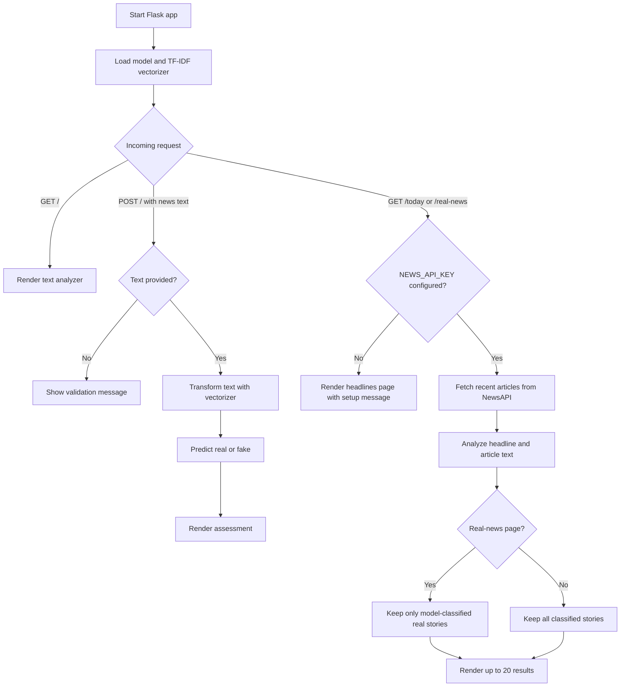
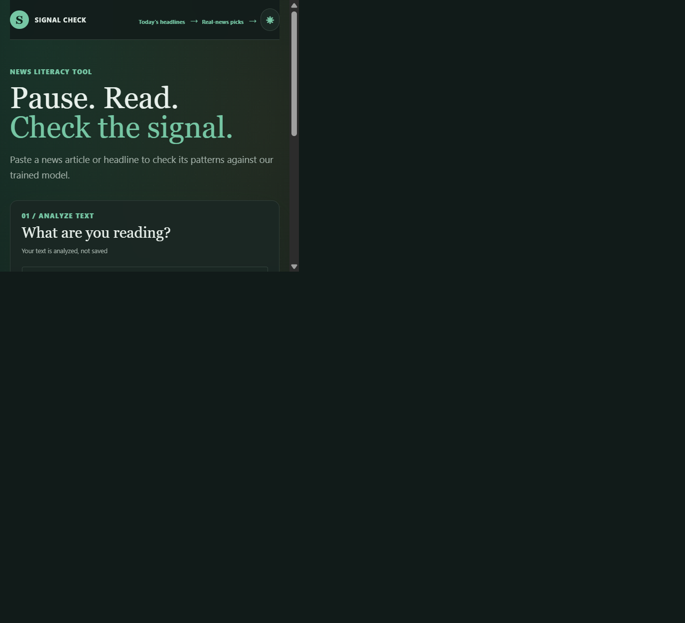

# Signal Check

Signal Check is a Flask web app that uses a trained machine-learning model to estimate whether a news headline or article resembles real or fake news. It also offers recent English-language headlines from NewsAPI and shows the model's assessment of each story.

> **Disclaimer:** Model results are automated estimates, not independent fact-checks. Verify claims with reliable sources.

## Features

- Analyze pasted headlines or article text.
- Browse recent headlines from NewsAPI and see model assessments.
- View headlines that the model classifies as real.
- Search, filter, and save headlines in the browser.
- Switch between light and dark themes.

## Application flow



## Screenshot

The screenshot below shows the running Signal Check text analyzer:



## Requirements

- Python 3
- A NewsAPI API key for the live headlines pages. Text analysis works without it.

Install the Python dependencies from the project root:

```powershell
py -m venv .venv
.\.venv\Scripts\Activate.ps1
python -m pip install -r requirements.txt
```

## Run the app

Set `NEWS_API_KEY` in the current PowerShell session if you want to use the live headlines pages:

```powershell
$env:NEWS_API_KEY = "your_newsapi_key"
```

Then start the Flask app:

```powershell
python app.py
```

Open [http://127.0.0.1:5000](http://127.0.0.1:5000) in your browser. The app loads the trained model and text vectorizer from `models/model.pkl` and `models/vectorizer.pkl`.

## Project contents

- `app.py` — Flask app and prediction/headline routes.
- `templates/` and `static/` — HTML templates, styles, and browser interactions.
- `models/` — serialized model and vectorizer used by the app.
- `data/` — training datasets.
- `model.ipynb` — model training notebook.
- `predict.py` — command-line example for running a prediction.
- `requirements.txt` — Python dependencies.

## Routes

- `/` — enter text for a model assessment.
- `/today` — browse recent headlines from NewsAPI.
- `/real-news` — browse headlines classified as real by the model.
